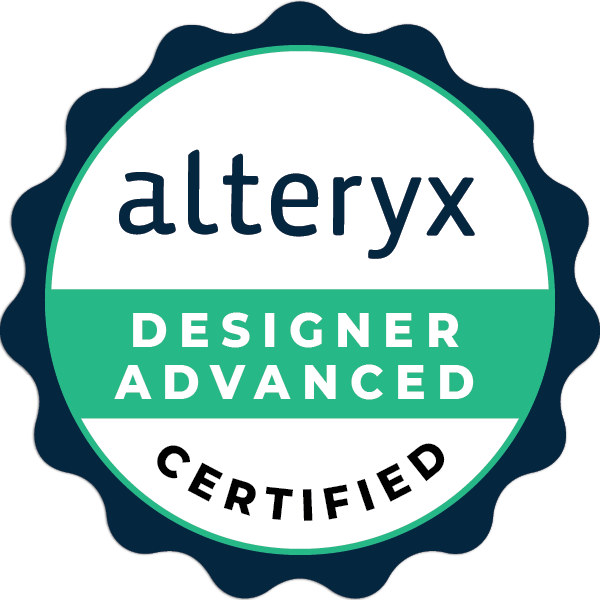
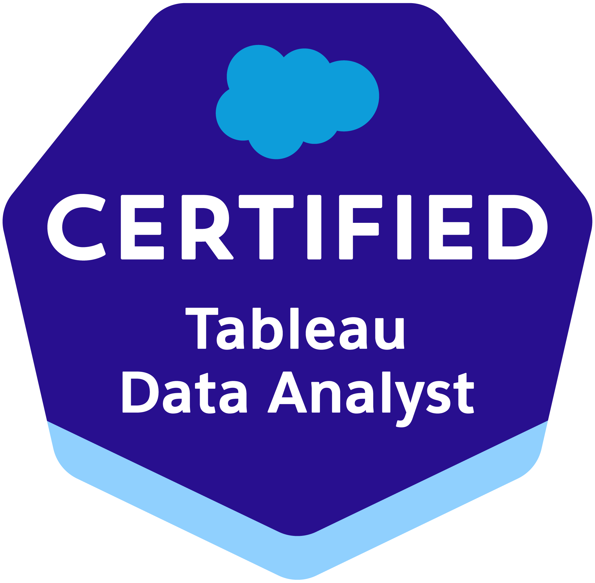
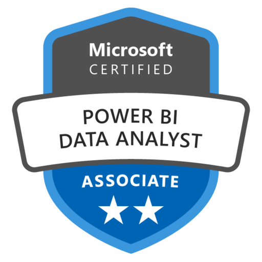
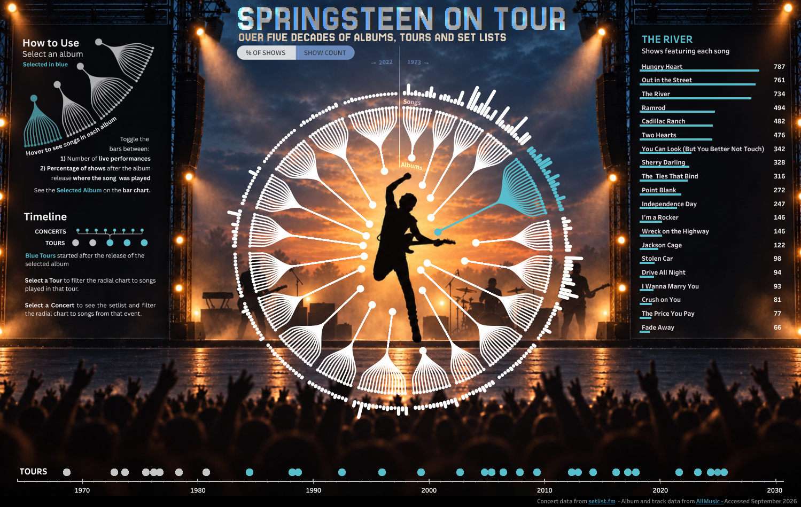
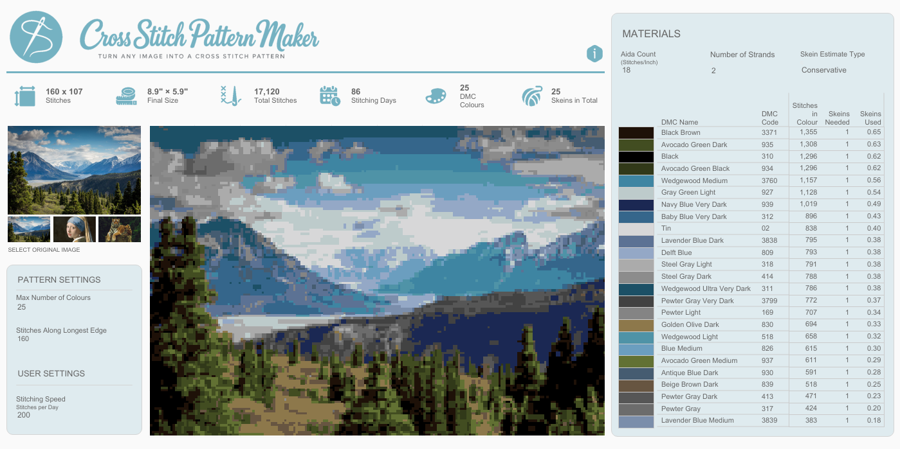
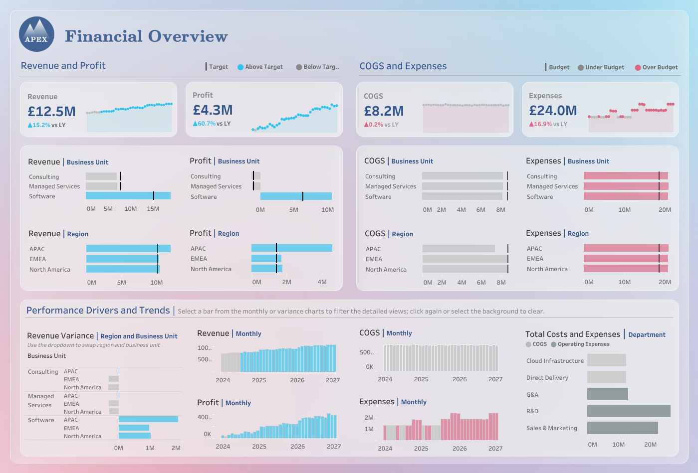
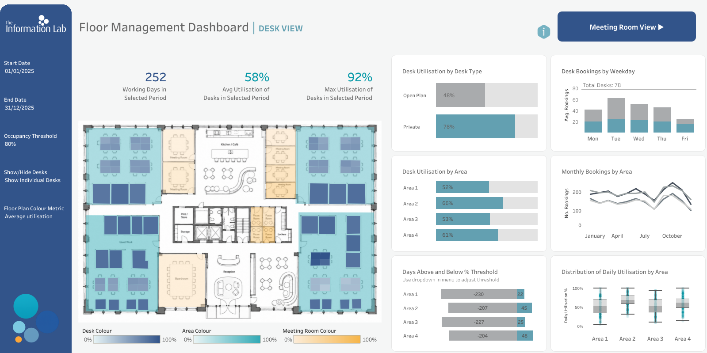
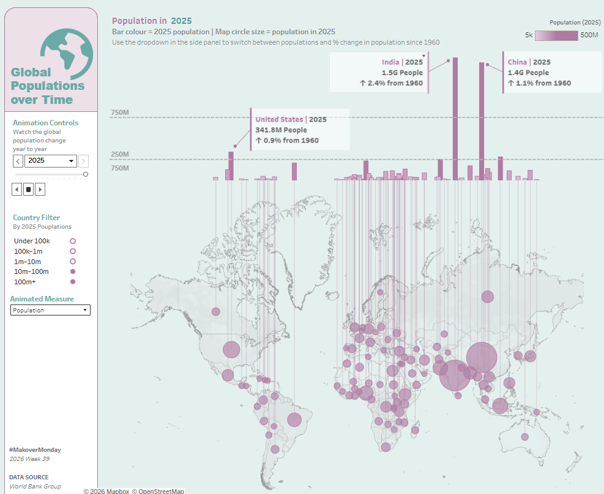

<!-- PROFILE LINKS -->

  
  &nbsp;
  
  &nbsp;
  

# Hi there, I'm Holly! 👋

**Data Consultant @ The Information Lab**  
*Data Analytics · Data Visualisation · Data Engineering*

  
  
  
  
  
  

I'm a data consultant with a background in chemistry and scientific research, and I love projects that combine technical problem-solving with a bit of creativity.

Through my training at The Data School, I've developed skills in data preparation, analytics and visualisation, working with tools including Tableau, Power BI and Alteryx. More recently, I've been building on that foundation by exploring data engineering, using Python and SQL to develop data pipelines and gain a deeper understanding of the whole data lifecycle.

---

### 🏅 Certifications

  
  &nbsp;
  
  &nbsp;
  
  &nbsp;
  

<!-- Replace credential URL placeholders with your verification links.
     Until then, remove the surrounding <a> tags if you don't want inactive links. -->

---

### ⚙️ Recent Projects

| Project | Description | Tools |
|:---|:---|:---|
| 🔬 **[OpenAlex Research Landscape](https://github.com/hollyxandersen/OpenAlex-DEng-Application-Example-Pipeline)** | Building a reproducible pipeline to extract, model and analyse scientific publication data, including API pagination, checkpointing and SQL transformations. | `Python` `SQL` `DuckDB` |
| 🍳 **[Recipe Unit Converter](https://github.com/hollyxandersen/deng-example1-Recipe-Unit-Converter)** | Built a Streamlit app to parse unstructured recipes and convert ingredient measurements using API reference data. | `Python` `APIs` `Streamlit` |
| 🧩 **Preppin' Data Challenges** | Solving data preparation challenges using Python and SQL, with a focus on cleaning, reshaping and transforming datasets. | `Python` `SQL` |
| 💻 **LeetCode Solutions** | A collection of coding and SQL solutions to develop my problem-solving skills. | `Python` `SQL` |
| 🧵 **[Cross-Stitch Pattern Maker](https://github.com/hollyxandersen/Cross-Stitch-Patter-Maker)** | Created an interactive pattern builder by transforming image data and connecting Python with Tableau. | `Python` `TabPy` `Tableau` |

<!-- Add repository links for OpenAlex, Preppin' Data and LeetCode once published. -->

---

### 🎨 Data Visualisation

My work in data visualisation has ranged from personal projects combining creative and technical skills to developing dashboards that make complex information accessible and useful to different audiences.

Below is a selection of my work — click on any image to explore the interactive visualisation on Tableau Public.

  <!-- TOP ROW: TWO LARGE IMAGES -->

  
  

  

  <!-- BOTTOM ROW: THREE SMALLER IMAGES -->

  
  
  

  

---

### ✍️ Check out some blogs

📖 **[Read my blogs at The Data School](https://www.thedataschool.co.uk/blog/holly-andersen/)**

<!-- Add featured articles here:
- Custom Tableau Bars tutorial
- Power BI Floor Plan blog
- Cross-Stitch Pattern Maker walkthrough
-->

---

  Thanks for visiting! 👋

